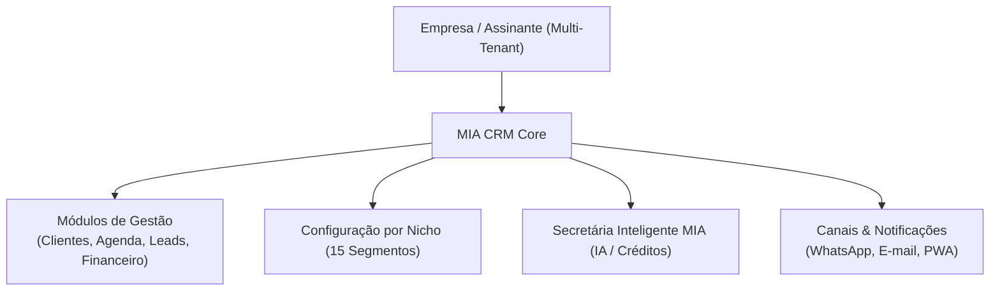
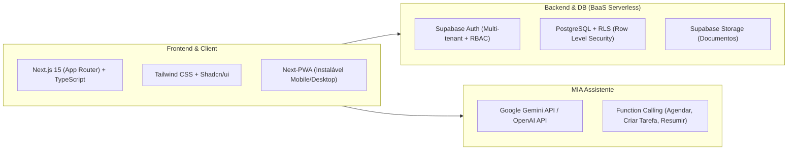
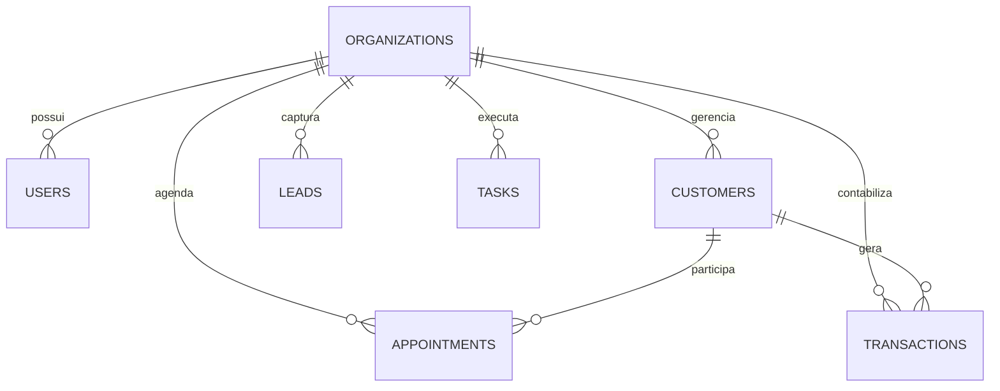

# Documento de Arquitetura e Plano de Projeto: MIA CRM Inteligente

> **Documento Base:** Análise das diretrizes visuais, regras de negócio e especificações do produto MIA CRM Inteligente (idealizado por Thayná de Oliveira).

---

## 1. Visão Geral do Produto e Modelo de Negócio

O **MIA CRM Inteligente** é um SaaS B2B Multi-tenant voltado para microempresas, prestadores de serviços e profissionais autônomos. O grande diferencial competitivo é aliar a gestão integrada (clientes, agenda, atendimentos, financeiro) a uma **Assistente Virtual Inteligente (MIA)**, com experiência adaptável a até **15 nichos de mercado**.

### 1.1 Tiers de Assinatura e Limites da Plataforma
A arquitetura precisa controlar estritamente as cotas de cada plano via middleware/banco:

| Recurso | MIA Essencial (R$ 59,90/mês) | MIA Profissional (R$ 129,90/mês) | MIA Business (R$ 249,90/mês) |
| :--- | :--- | :--- | :--- |
| **Usuários da Equipe** | 1 usuário | Até 3 usuários | Até 5 usuários |
| **Base de Contatos** | Até 300 contatos | Até 1.500 contatos | Até 5.000 contatos |
| **Créditos de IA (MIA)** | 30 créditos/mês | 150 créditos/mês | 400 créditos/mês |
| **Funcionalidades** | Gestão básica, Agenda, Tarefas, Relatórios simples | Funil de leads, Automações básicas, Relatórios de conversão | Automações avançadas, processos por nicho, relatórios customizados |
| **Suporte** | E-mail | Prioritário | Prioritário + Acompanhamento |

---

## 2. Design System & Identidade Visual

O sistema adota uma identidade moderna, contrastante e acolhedora:

* **Paleta de Cores:**
  * Primária (Amarelo MIA): `#FFC107` / `#FFB800` (Acentos, botões de ação principal, status ativo)
  * Neutro Escuro (Preto Sofisticado): `#111111` / `#1A1A1A` (Sidebar, tipografia de destaque, cards em dark mode)
  * Neutro Claro (Creme Leve): `#FFF8E7` / `#FAF6F0` (Background suave, áreas de descanso visual)
  * Superfície (Branco): `#FFFFFF` (Cards de conteúdo, tabelas, modais)
  * Cores Semânticas: Verde Sucesso (`#10B981`), Vermelho Alerta (`#EF4444`), Azul Info (`#3B82F6`)
* **Tipografia:** `Poppins` (Google Fonts) — Pesos 400 (Regular), 500 (Medium), 600 (SemiBold), 700 (Bold).
* **Mascote MIA:** Abelinha simpática com headset, presente no widget interativo de IA, onboarding e estados vazios (empty states).

---

## 3. Matriz de Módulos do Sistema

O CRM conta com **12 módulos integrados**:

1. **Dashboard Executivo:** Métricas em tempo real (Clientes ativos, Agendamentos do dia, Atendimentos concluídos, Tarefas pendentes, Faturamento mensal acumulado, Leads recentes e Timeline da agenda).
2. **Clientes (CRM):** Cadastro completo, histórico de agendamentos, notas, anexos e segmentações.
3. **Leads & Oportunidades:** Funil de vendas (Kanban) com estágios personalizáveis e integração de canais de captação.
4. **Agenda Inteligente:** Calendário interativo (dia/semana/mês), agendamento rápido com bloqueio de conflitos e lembretes.
5. **Atendimentos & Serviços:** Gestão do ciclo de atendimento (em andamento, finalizado, retorno), catálogo de serviços e precificação.
6. **Tarefas & Checklists:** Gestão operacional diária para a equipe com prazos e status.
7. **Processos Operacionais:** Workflows específicos e checklists padronizados pré-configurados para o nicho da empresa.
8. **Financeiro:** Gestão de fluxo de caixa (contas a receber e a pagar), faturamento por período e ticket médio.
9. **Documentos:** Gestão de arquivos de clientes, orçamentos, contratos e termos de consentimento.
10. **Comunicações:** Histórico de contato, envio de notificações e links rápidos de WhatsApp com mensagens pré-formatadas.
11. **Relatórios & Indicadores:** Relatórios de vendas, conversão de leads, serviços mais rentáveis e produtividade.
12. **Equipe & Permissões (RBAC):** Gestão de membros com papéis de Administrador, Gerente ou Operador.
13. **Configurações & Nichos:** Seletor do nicho de atuação da empresa que altera termos da interface (ex: "Paciente" para Saúde, "Cliente" para Comércio, "Caso" para Jurídico).

---

## 4. Stack Tecnológica Recomendada

Para entregar com máxima velocidade de freelancer, alta confiabilidade e baixo custo de infraestrutura inicial:

* **Frontend:** **Next.js 15 (React 19)** + **TypeScript** + **Tailwind CSS** + biblioteca de componentes **Shadcn/UI** + ícones **Lucide-React**.
* **PWA:** Suporte a Progressive Web App (manifest.json, service worker e instalação na tela inicial com visual de app nativo).
* **Backend & Banco de Dados:** **Supabase** (PostgreSQL com Row-Level Security para isolamento total de tenants, autenticação pronta, realtime e upload de documentos) ou **Node.js/Prisma + PostgreSQL**.
* **Motor da Secretária MIA (IA):** API de LLM com chamadas estruturadas de ferramentas (Function Calling) conectadas à API do CRM para:
  * Criar agendamento a partir de mensagem em linguagem natural.
  * Resumir histórico do cliente antes de uma reunião ou consulta.
  * Adicionar itens na lista de tarefas.
  * Gerar respostas rápidas para WhatsApp.

---

## 5. Estratégia de Banco de Dados Multi-Tenant (RLS)

Cada empresa cadastrada no SaaS possui um `tenant_id` (`organization_id`). O isolamento de dados é garantido diretamente no banco via **Row Level Security (RLS)** do PostgreSQL:

---

## 6. Roadmap de Desenvolvimento (Fases do Freelance)

Para garantir previsibilidade e entregas parciais de valor para a contratante:

### 🚀 Fase 1: Fundação & MVP Essencial (Sprints 1 e 2)
* [ ] Setup do repositório, Next.js, Tailwind e Design System (cores da MIA, Poppins, layout responsivo e PWA).
* [ ] Autenticação multi-tenant e seleção do nicho no cadastro.
* [ ] **Dashboard Principal** com cartões de KPIs e atalhos rápidos.
* [ ] **Módulo de Clientes**: listagem, criação, edição e ficha do cliente.
* [ ] **Módulo de Agenda**: calendário mensal/semanal e criação de compromissos.
* [ ] **Módulo de Tarefas**: kanban simples e checklists de rotina.

### 📈 Fase 2: Atendimentos, Leads & Financeiro (Sprints 3 e 4)
* [ ] **Módulo de Leads**: funil kanban de prospecção com follow-up.
* [ ] **Módulo de Atendimentos**: registro de sessões/serviços realizados.
* [ ] **Módulo Financeiro**: entradas, saídas, faturamento e fluxo de caixa.
* [ ] Controle de limites por plano (contatos, usuários e cotas).

### 🤖 Fase 3: Secretária MIA (IA) & Comunicações (Sprints 5 e 6)
* [ ] Widget flutuante da assistente MIA com microfone/texto.
* [ ] Integração com IA (Function calling para agendar, resumir e buscar dados).
* [ ] Sistema de créditos de IA por plano (30 / 150 / 400).
* [ ] Atalhos de WhatsApp (click-to-chat com templates automáticos).
* [ ] Configuração de permissões da equipe (Admin vs Colaborador).
